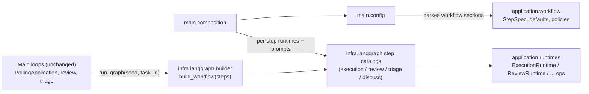
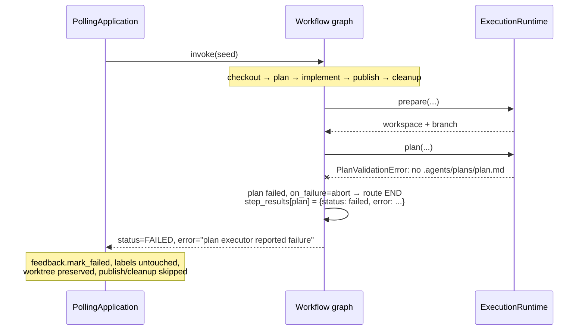

# Plan — YAML-configurable LangGraph workflows (rev. 2)

Goal, decisions, and implementation roadmap for making the processing steps of every
orchestrator stage configurable in YAML. Status: draft, approved direction (removed the
dedicated test step; validation stays inside the implement agent).

## Goal

Make the *processing steps* of each stage configurable in `config/config.yaml`, while the
main loops (`PollingApplication`, review, triage, and their feedback/label handling) stay
untouched. Today only providers are configurable; the step sequence is hardcoded in five
places:

| Path | Steps today |
|---|---|
| Execution issue graph (`infra/langgraph/graph.py`) | `checkout → (plan) (implement) (publish) (cleanup)` |
| `/ai-agent-impl` (`ExecutionRuntime.run_incremental`) | prepare(reuse) → implement_comment → publish → cleanup |
| `/ai-agent-discuss` (`DiscussionRuntime.run`) | detached checkout → agent → publish |
| Review (`ReviewApplication.poll_once`) | prepare → execute_review → publish (+ `finally` cleanup) |
| Triage (`TriageApplication.poll_once`) | assess → publish |

## Confirmed requirements

1. **Step kinds**: fixed named types per stage, plus a generic `agent` step (custom prompt
   run) and an optional generic `command` step (shell in the workspace) reserved for
   custom cases. **No dedicated test/QA step** — tests and quality checks remain part of
   the implement agent's prompt contract (current behavior, per PLAN.md §13–14).
2. **Per-step overrides**: executor type, model (`name`/`variant`), prompt (`prompt_file`),
   `on_failure: abort | continue` (abort = default).
3. **Scope**: all stages + both comment commands become step-configurable.
4. **Main loop** stays exactly as-is: events in, graphs out; labels/reactions/assignment
   remain loop-owned.

**Constraints & non-goals:** linear chains only (no DAG/fan-out), no checkpoint
persistence (graph stays in-memory; GitHub labels remain durable state), no retries on
agent steps, no per-repo workflows, no `WAITING_FOR_HUMAN` nodes, no separate test step.
Defaults reproduce today's behavior exactly — existing config files keep working.

## Design

### Config schema (v1)

```yaml
pipeline:
  execution:
    workflow:                      # issue-triggered run
      steps:
        - {name: checkout, type: checkout}
        - {name: plan,    type: plan, model: {name: verboo/deepseek-v4-flash}}
        - {name: implement, type: implement}
        - {name: cleanup, type: cleanup, on_failure: continue}
    comments:
      impl:
        workflow:
          steps:
            - {name: checkout, type: checkout}
            - {name: implement, type: implement_comment}
            - {name: publish, type: publish}
            - {name: cleanup, type: cleanup}
      discuss:
        workflow:
          steps:
            - {name: checkout, type: checkout}
            - {name: answer, type: discuss}
            - {name: publish, type: publish}
  review:
    workflow:                      # checkout / review / publish; cleanup stays loop-owned
      steps:
        - {name: checkout, type: checkout}
        - {name: review, type: review}
        - {name: publish, type: publish}
  triage:
    workflow:
      steps:
        - {name: assess, type: assess}
        - {name: publish, type: publish}
```

Step fields: `name` (required, slug `^[a-z][a-z0-9_-]{0,39}$`, unique), `type`,
`on_failure` ("abort" default | "continue"), and optional `executor: {type: claude}`,
`model: {name, variant}`, `prompt_file: prompts/plan.md` for agent-bearing steps.
Omitting `workflow` (or a whole stage) uses the built-in defaults — fully backward
compatible. Precedence for agent steps: built-in defaults → stage config/env →
**step override**.

### Stage catalogs (step type → runtime operation)

| Type | Stage | Maps to |
|---|---|---|
| `checkout` | execution / comment-impl | `ExecutionRuntime.prepare` (comment variant sets `reuse_workspace=True`) |
| `plan` | execution | `runtime.plan` (keeps the `.agents/plans/plan.md` contract) |
| `implement` / `implement_comment` | execution / comment-impl | `runtime.implement` / `implement_incremental` |
| `publish` | all | `publish` ops of each runtime |
| `cleanup` | execution / comment-impl | `runtime.cleanup` — only runs if the chain reaches it (matches today: failed worktrees are preserved) |
| `review` | review | `ReviewRuntime.execute_review` (JSON-outcome contract) |
| `assess` | triage | inline executor call + temp dir + prompt |
| `discuss` | discuss | `DiscussionExecutor.execute` |
| `command` *(generic, unused by defaults)* | execution / comment-impl / review | infra adapter, subprocess in the workspace; exit ≠ 0 ⇒ step failed |
| `agent` *(generic)* | execution / comment-impl | `runtime.execute_phase(AgentRequest(...))` with templated prompt (`{task_id}`, `{repository}`, `{title}`, `{description}`, `{extra_context}`); `agent:` param (opencode agent name, default `build`) |

Semantics preserved from today: execution/comment cleanup only on success;
review/discussion cleanup stays a guaranteed epilogue in the poll loop's `finally` (not
configurable — deliberately outside the graph). If a workflow omits `plan`, the
plan-artifact contract simply doesn't apply (documented).

### Failure routing

- A step returns `status: FAILED` when its operation raises (e.g. plan file missing/empty,
  executor non-zero exit, allowlist rejection) →
  `processing.step_results[name] = {status, error, duration}`.
- `abort` (default) → route to END with `status: FAILED` (same as today, publish skipped).
- `continue` → record failure, keep going; final status stays `COMPLETED` if no *later*
  fatal failure — matching today's cleanup-error behavior.
- New state channel: `TaskState.processing.step_results` (nested dict keyed by step name;
  each node writes only its own entry, so parallel-safe). Node name = step name ⇒
  `make logs TASK --node <step>` and `append_event(node=...)` observability keep working
  unchanged.

## Pattern decision

```
Pattern decision:
- force: YAML-declared steps must bind to different runtime operations per stage and be
  selected at runtime; unknown types must fail fast at composition. An if/elif in the
  builder would duplicate dispatch logic per stage and hide unknown types until run time.
- response: reuse the repository's existing ProviderRegistry interpreter pattern as
  per-stage step catalogs (type → node factory). The catalogs feed both config
  validation and graph building, so one source of truth lives in
  infra/langgraph/steps*.py; builder.py only chains specs through generalized
  conditional edges (generalization of the existing `_route`).
- cost / rejected: one more registry indirection to read when adding a step type ·
  rejected a Step base-class hierarchy (over-structure for closures over runtime ops)
  and self-contained builders per stage (duplicated routing/failure logic).
```

## Diagrams





## File-by-file plan, phased (each phase ships independently)

### Phase 1 — engine + execution stage (the core)

1. **New `src/orchestrator/application/workflow/__init__.py` + `models.py`** — pure
   dataclasses: `StepSpec`, `FailurePolicy`, per-stage catalog name constants
   (`EXECUTION_STEP_TYPES`, ...), `DEFAULT_*_STEPS` lists, `StepConfigError`.
2. **New `src/orchestrator/infra/langgraph/builder.py`** —
   `build_workflow(steps, factories, state_schema, on_node_start)`: per-step nodes,
   conditional edges, abort/continue router, `step_results` bookkeeping in the existing
   `guard` wrapper. `infra/langgraph/graph.py` becomes a thin wrapper: move its node
   bodies to the catalog and keep `build_graph(runtime=...)` so `test_graph.py` keeps
   passing.
3. **New `src/orchestrator/infra/langgraph/execution_steps.py`** — execution +
   comment-impl catalogs (incl. the generic `agent`/`command` types).
4. **New `src/orchestrator/infra/filesystem/command.py`** —
   `run_workspace_command(workspace, command, timeout)` returning `ExecutionResult`-shaped
   output; new env `ORCHESTRATOR_COMMAND_TIMEOUT` (default 3600).
5. **`main/config.py`** — parse `pipeline.*.workflow` + `pipeline.execution.comments.*`
   into `StepSpec` lists (validated via `main/providers.py`-style registries + catalog
   constants).
6. **`main/composition.py`** — compose default runtime + per-step runtime variants
   (executor/model overrides → extra `ExecutionRuntime` instances sharing workspace
   manager/destination), load `prompt_file` contents at startup (fail fast), hand specs
   to runners.
7. **`main/cli.py`** — `_run_graph` builds from configured steps; comment runners keep
   current behavior in P1 (they become graphs in P2).
8. **`application/execution/service.py`** — add `run_command` op; no behavior changes to
   existing ops.

### Phase 2 — comment paths

Move `_run_incremental_comment` / discussion flow onto comment-impl/discuss graphs
(additive `node_start`/`node_end` events for comment runs);
`application/discussion/service.py` + `discussion_steps.py`.

### Phase 3 — review

`review_steps.py`; `ReviewApplication.poll_once` inner flow → review graph (loop's
`finally` cleanup untouched). New small review state TypedDict in
`infra/langgraph/state.py` (same `input/processing/workspace/output` namespaces).

### Phase 4 — triage

`triage_steps.py`; `TriageApplication.poll_once` inner flow → triage graph.

### Docs

README (workflow schema, per-stage catalogs, `on_failure` semantics, precedence table —
noting validation happens inside the implement agent, not as a step),
`config/config.example.yaml` commented sections.

## Test strategy

- `test_config.py`: workflow parsing/validation — unknown type, duplicate/slug names,
  empty steps, unknown executor override (registry check), missing `prompt_file`,
  defaults = current behavior.
- New `test_workflow_models.py`: `StepSpec` rules.
- Extend `test_graph.py` (existing `FakeRuntime` pattern): default build ⇒ identical node
  order (`prepare_workspace, plan, implement, create_pr, cleanup`); custom steps; `agent`
  step prompt templating; per-step executor override selects the override runtime
  instance; plan step raising `PlanValidationError` → abort ⇒ publish skipped,
  `status=FAILED`; `on_failure: continue` on cleanup failure ⇒ chain reaches END with
  `COMPLETED` (matches today); `command` step failure routing covered by the generic
  adapter path.
- New `test_command.py`: timeout, exit codes, stderr capture; `test_runtime.py`:
  `run_command` op.
- Phases 2–4 mirror the same per-stage graph tests.

## Risks & rollout

- **Highest risk**: prompt files replacing built-in prompts drop the "do not create a PR
  / plan-only" guardrails — mitigate with documented warnings and honest full-replacement
  semantics (no magic appending).
- **Env fallbacks** (`ORCHESTRATOR_EXECUTOR_*`) interplay with step overrides — precedence
  documented, tests pin it.
- **Startup-time failure capture**: all YAML issues fail at composition; a bad config
  aborts `execute` before polling.
- **No checkpointing** — unchanged posture: GitHub labels/assignment remain the durable
  truth.
- Rollout is opt-in: without `workflow:` keys, behavior is byte-identical (defaults
  pinned by tests).

## Assumptions

1. Steps are YAML-only (no env overrides for steps; existing env keys keep controlling
   stage defaults).
2. `timeout_seconds` on the generic `command` step with a global default; no timeouts on
   agent steps in v1.
3. The plan file contract (`.agents/plans/plan.md`) lives in the `plan` step; omitting
   `plan` omits the contract.
4. Review/discussion cleanup stays loop-owned (`finally`), not a configurable step.
5. Generic `command`/`agent` types remain in the catalog (fixed + generic was the
   approved choice); no default workflow uses them.
